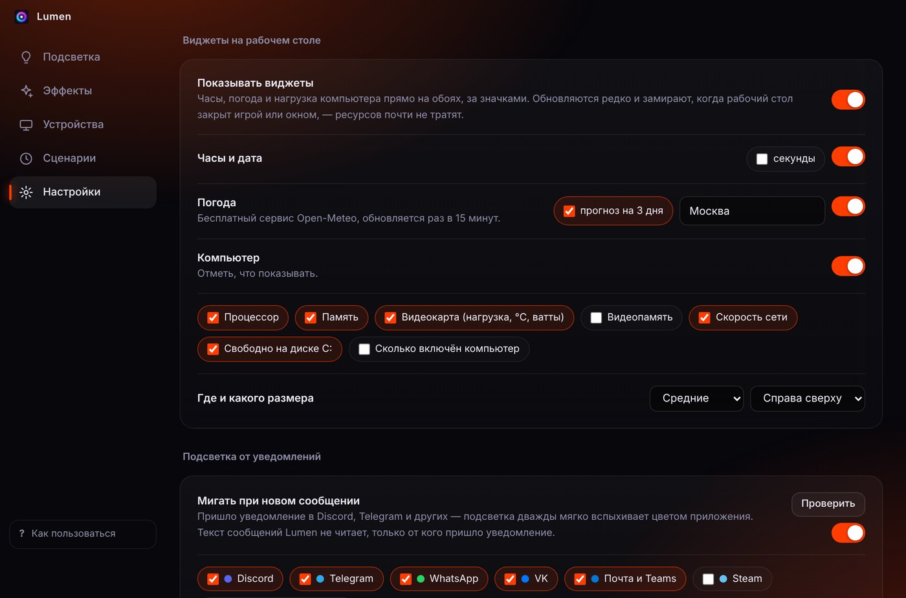

  

  
  
  
  

<h3 align="center">
  <a href="https://github.com/1MPOSS1BLE228/Lumen/releases/latest">⬇️ Скачать для Windows</a>
  &nbsp;·&nbsp;
  <a href="docs/install-guide.pdf">Как установить (PDF)</a>
  &nbsp;·&nbsp;
  <a href="#english">English</a>
</h3>

  Плата, видеокарта, оперативная память, вентиляторы, водянка, клавиатура и мышь — 
  <b>из одного красивого окна</b>, без SignalRGB, iCUE, Armoury Crate и десятка фирменных программ.

  

## Почему Lumen

- **Одна программа вместо пяти.** У каждого производителя своя утилита для подсветки, и они мешают друг другу. Lumen управляет всем сразу: встроенный движок [OpenRGB](https://openrgb.org) и «Динамическая подсветка» Windows 11.
- **Красиво из коробки.** 19 готовых тем — нажал, и подсветка, цвет Windows и обои на рабочем столе стали одного настроения.
- **Не мешает играть.** Почти не тратит процессор и видеокарту, сам замирает в играх и полноэкранных окнах.
- **Бесплатно и открыто.** Без рекламы, регистрации и сбора данных. Весь код — здесь, установщик собирается автоматически на GitHub.

## Что умеет

### 🎨 Темы и эффекты

Киберпанк, Аврора, Лава, Неон Токио, Матрица и ещё 14 тем. Или собери свою: **15 эффектов** — волна, дыхание, огонь, комета, радуга, северное сияние, мерцание. Кнопка **«Удиви меня»** придумает случайную красивую тему, а понравившуюся можно сохранить и отправить другу одним кодом.

### 🖥️ Рабочий стол под цвет подсветки

Lumen красит **панель задач, меню «Пуск» и окна** в цвет темы и меняет обои: живые волны, абстракции или **фото в высоком разрешении** из каталога Wallhaven — под твой монитор, со слайд-шоу. Выйдешь из Lumen — прежнее оформление вернётся.

### 📊 Виджеты на рабочем столе

**Часы, погода с прогнозом на 3 дня, загрузка и температура** процессора, памяти и видеокарты, скорость сети, свободное место на диске — прямо на обоях, за значками. Сам выбираешь, что показывать, в каком углу и какого размера.

### 📱 Пульт на телефоне

Наведи камеру на QR-код в настройках — и управляй подсветкой с телефона: включить, выключить, яркость, темы. **Без приложений**, прямо в браузере, только в твоей домашней сети.

  
  &nbsp;&nbsp;
  

### 🎵 Подсветка, которая живёт

- **Цвет под музыку** — берёт цвета с обложки трека в Spotify, Яндекс Музыке или YouTube.
- **Реакция на звук** — пульсирует в такт.
- **Цвет экрана** — повторяет картинку на мониторе, как Ambilight.
- **Температура** — синий, когда видеокарта холодная, красный, когда горячая.
- **Уведомления** — мягкая вспышка цветом Discord, Telegram, WhatsApp, VK.

### 🎮 Сценарии

Запустил игру — включилась её тема. Ночью — тёплый ночник или полная темнота. Отошёл от компьютера или заблокировал его — подсветка погасла. Вернулся — зажглась. **Горячие клавиши** работают даже в играх.

И ещё: мини-гайд для новичков при первом запуске, **автообновление** с проверкой контрольной суммы, отчёт о проблеме одной кнопкой, интерфейс на **русском, английском, украинском, немецком и испанском**.

## Какое железо поддерживается

Lumen работает через [OpenRGB](https://openrgb.org/devices.html) — он знает **тысячи устройств**: материнские платы ASUS Aura, MSI Mystic Light, Gigabyte RGB Fusion, ASRock, видеокарты, оперативную память (G.Skill, Kingston Fury, Corsair и др.), контроллеры вентиляторов и ленты, клавиатуры и мыши Corsair, Logitech, Razer, SteelSeries, HyperX. Плюс всё, что поддерживает «Динамическую подсветку» Windows 11.

Подсветка оперативной памяти включается одной кнопкой — нужный драйвер Lumen поставит сам.

## Установка

1. Скачай **`Lumen-Setup-….exe`** со страницы [последней версии](https://github.com/1MPOSS1BLE228/Lumen/releases/latest).
2. Запусти и нажимай «Далее». Lumen запустится сам и коротко покажет, где что находится.
3. Если Windows пишет **«Интеллектуальное управление приложениями заблокировало приложение»** — это потому, что у бесплатной программы пока нет платной подписи разработчика. Что сделать — в **[гайде на одну страницу (PDF)](docs/install-guide.pdf)**.

Дальше Lumen обновляется сам.

Free code signing provided by [SignPath.io](https://about.signpath.io), certificate by [SignPath Foundation](https://signpath.org) — подробнее в [docs/CODE_SIGNING.md](docs/CODE_SIGNING.md).

## Горячие клавиши

| Клавиши | Что делают |
|---|---|
| <kbd>Ctrl</kbd>+<kbd>Alt</kbd>+<kbd>L</kbd> | включить / выключить подсветку |
| <kbd>Ctrl</kbd>+<kbd>Alt</kbd>+<kbd>PageUp</kbd> / <kbd>PageDown</kbd> | следующая / предыдущая тема |
| <kbd>Ctrl</kbd>+<kbd>Alt</kbd>+<kbd>=</kbd> / <kbd>-</kbd> | ярче / тусклее |
| <kbd>Ctrl</kbd>+<kbd>Alt</kbd>+<kbd>R</kbd> | «Удиви меня» — случайная тема |

## Частые вопросы

<b>Это безопасно?</b>

Код полностью открыт, а установщик собирается из него автоматически на серверах GitHub — каждую версию можно проверить. Lumen ничего не отправляет в интернет, кроме запросов погоды, фото для обоев (если включил) и проверки обновлений. Текст твоих уведомлений он не читает — только от какого приложения они пришли.

<b>Подсветка не меняется или не видно какого-то устройства</b>

1. Закрой SignalRGB, iCUE, Armoury Crate, G HUB и похожие программы — две программы не могут управлять одним устройством. Lumen сам предупредит, если такая запущена.
2. Не видно памяти — «Устройства» → «Включить подсветку памяти».
3. Вентиляторы на разъёмах платы — «Устройства» → «Настроить зоны»: сколько светодиодов и порядок цветов.
4. Не помогло — «Настройки» → «Сообщить о проблеме». Lumen соберёт архив с журналами и списком оборудования (без личных данных) — приложи его к [новой задаче](https://github.com/1MPOSS1BLE228/Lumen/issues/new).

<b>Сильно грузит компьютер?</b>

Нет. Окно можно закрыть — Lumen останется в трее возле часов и почти ничего не потребляет. Живые обои и виджеты сами замирают в играх и при развёрнутых окнах.

<b>Можно предложить идею или помочь?</b>

Конечно — пиши в [задачи (Issues)](https://github.com/1MPOSS1BLE228/Lumen/issues). А если Lumen понравился — поставь ⭐ репозиторию, так его найдут другие.

## Сборка из исходников

- Быстро на своём компьютере: дважды кликни `Собрать-установщик.bat` — поставит Node.js и соберёт установщик в `dist`.
- Вручную: `npm install --no-save electron@45.0.0 electron-builder@26`, затем `npm test` и `npm run dist`.
- Выпуск: поменяй версию в `package.json`, допиши `CHANGELOG.md` и отправь в `main` — установщик соберёт, поставит метку `vX.Y.Z` и опубликует GitHub Actions (`.github/workflows/release.yml`).

Переводы — `src/shared/i18n/table.tsv` (колонки: русский, English, Українська, Deutsch, Español);
после правки: `python scripts/gen-i18n.py src/shared/i18n/table.tsv src/shared/i18n.js`.

## English

**Lumen** is a free, open-source Windows 10/11 app that controls all your PC RGB lighting from one place — motherboard, GPU, RAM, fans, keyboard and mouse — without SignalRGB, iCUE or vendor tools. It ships with 19 themes and 15 effects (wave, fire, music-reactive, screen ambient, GPU temperature), matches the Windows accent color and wallpaper to your lighting, shows desktop widgets (clock, weather, system load), flashes on notifications, takes colors from the album art of the current track and can be controlled from your phone. The UI is available in English, Russian, Ukrainian, German and Spanish.

[**Download the latest version**](https://github.com/1MPOSS1BLE228/Lumen/releases/latest). If Windows Smart App Control blocks the installer, see the [install guide (PDF, Russian)](docs/install-guide.pdf) — in short: Windows Security → App & browser control → Smart App Control settings → Off.

## Лицензии

Lumen — свободная программа под лицензией [GNU GPL v3.0](LICENSE).
В установщик входят:
- [OpenRGB](https://codeberg.org/OpenRGB/OpenRGB) (GNU GPL v2.0) — движок подсветки, папка `vendor/OpenRGB`, без изменений;
- установщик драйвера [PawnIO](https://pawnio.eu) — без изменений, распространяется с разрешения автора («This installer can be redistributed unmodified»);
- [Electron](https://www.electronjs.org) (MIT).

Фото для обоев загружаются из [Wallhaven](https://wallhaven.cc), погода — [Open-Meteo](https://open-meteo.com).
